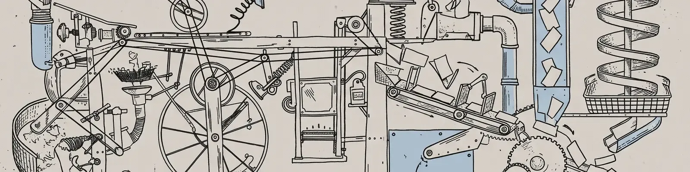

<picture>
  <source media="(prefers-color-scheme: dark)" srcset="assets/banner-dark.webp">
  
</picture>

### I build AI features and prove they work.

Specs before prompts, evals before launch, and an owner after it ships. I'm a software engineer with about five years on US and Western B2B SaaS teams. For the last three I've been a core engineer at Content Camel, a sales-enablement SaaS, where I shipped its first AI features and own large parts of the product end to end.

**Selected work**

- **The product's first AI features.** An LLM pipeline over CRM deal conversations that shows which content moves deals: schema validation at the boundary, entity resolution, and a confidence score on every link. [How it's built](https://hasanqaysi.dev/blog/crm-content-attribution-pipeline)
- **Always-on agents.** A multi-agent engineering system, and a content engine that researches, writes and opens publish-ready pull requests behind a human-approved brief.
- **A serverless backbone.** Event-driven services on AWS (SQS, Lambda, DynamoDB, SES, CloudFront and Lambda@Edge), and an AWS SDK v3 migration across 18 services.
- **Ground-up frontends.** The production browser extension and most of the v2 web app, rebuilt in Next.js and TypeScript.

**Writing**

<!-- BLOG-POST-LIST:START -->
- [I let an LLM read a sales team's CRM notes. Then I refused to trust it.](https://hasanqaysi.dev/blog/crm-content-attribution-pipeline)
- [Make a small team move like a big one](https://hasanqaysi.dev/blog/small-teams-big-output)
- [Shipping your first AI feature without losing the plot](https://hasanqaysi.dev/blog/first-ai-feature)
- [Event-driven on AWS serverless, from zero](https://hasanqaysi.dev/blog/serverless-from-zero)
<!-- BLOG-POST-LIST:END -->

TypeScript · Node · Next.js · React · Python · AWS · PostgreSQL · LLM pipelines and evals

[hasanqaysi.dev](https://hasanqaysi.dev) · [LinkedIn](https://www.linkedin.com/in/hasan-alqaysi/) · [hasanaqeel38@gmail.com](mailto:hasanaqeel38@gmail.com)
